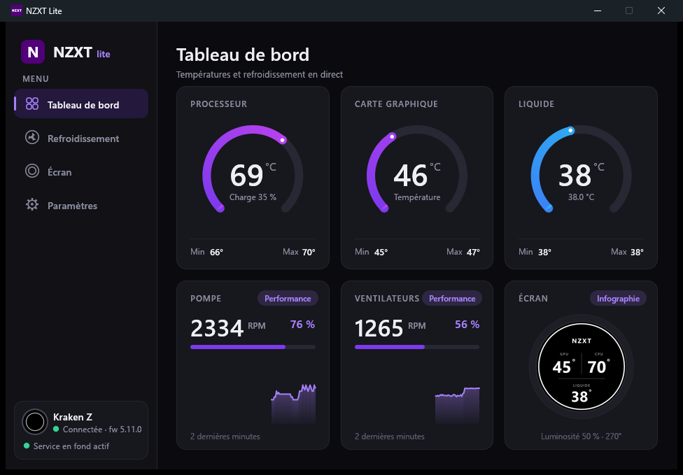
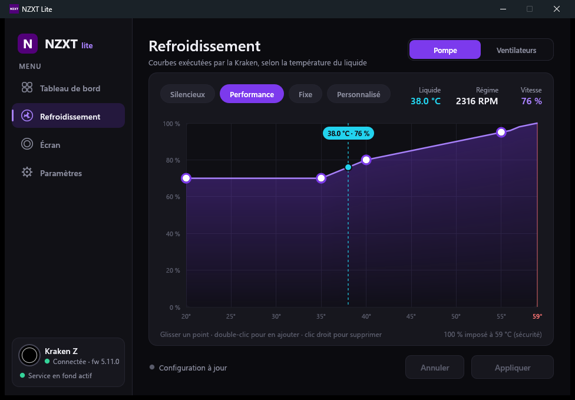
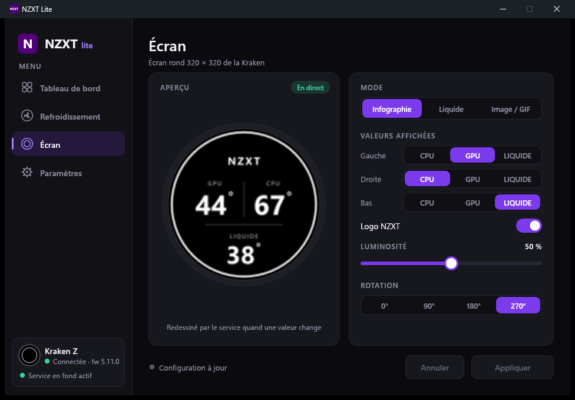
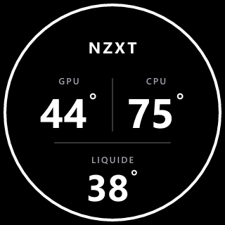

<div align="center">

# NZXT Lite

**Un remplaçant léger de NZXT CAM pour les AIO NZXT Kraken Z, écrit en Rust.**

Courbes pompe/ventilateurs, écran LCD (infographie CPU · GPU · liquide, image, GIF) et
icône dans la zone de notification, dans **~3 Mo de RAM** au lieu de ~650 Mo.




</div>

## Pourquoi

NZXT CAM est une application Electron : 5 processus, des centaines de Mo de RAM, des mises à
jour fréquentes et un service permanent, tout ça pour piloter un watercooling dont les courbes
tournent… dans le firmware de la Kraken. NZXT Lite fait le même travail avec un service natif
minuscule et une fenêtre qui n'existe que lorsqu'on l'ouvre.

| | NZXT CAM | NZXT Lite |
|---|---|---|
| En fond | ~650 Mo, 5 processus + service | **~3 Mo**, 1 processus |
| Fenêtre ouverte | (inclus ci-dessus) | ~14 Mo (rendu CPU, sans GPU) |
| Exécutable | ~400 Mo installés | ~6 Mo, aucune installation |
| Télémétrie / compte | oui | non |

## Fonctionnalités

- **Refroidissement** : courbes pompe et ventilateurs selon la température du liquide, éditeur
  de courbe (glisser, double-clic pour ajouter, clic droit pour supprimer), mode fixe et
  préréglages *Silencieux* / *Performance* identiques à ceux de CAM. Les courbes sont écrites
  dans la Kraken, qui les applique seule.
- **Écran LCD 320×320** :
  - *Infographie* façon « TripleInfographic » de CAM : trois valeurs au choix parmi CPU, GPU
    et liquide, avec logo NZXT. L'image n'est renvoyée que lorsqu'un chiffre affiché change.
  - *Température du liquide* : affichage intégré à la Kraken.
  - *Image ou GIF* : envoyé une fois, joué par l'écran lui-même.
  - Luminosité et rotation.
- **Tableau de bord** : jauges CPU, GPU et liquide (min/max de la session), régime et
  consigne de la pompe et des ventilateurs, historique de 2 minutes.
- **Zone de notification** : températures en info-bulle, clic pour ouvrir le panneau, menu
  *Ouvrir / Lancer au démarrage / Quitter*.
- **Robuste** : la configuration est réappliquée automatiquement après une sortie de veille,
  une reconnexion USB ou une modification de `config.toml`.

<table>
<tr>
<td></td>
<td></td>
</tr>
<tr>
<td align="center">Éditeur de courbe</td>
<td align="center">Réglages de l'écran avec aperçu en direct</td>
</tr>
</table>

<p align="center"><br>
<sub>Image envoyée à l'écran de la Kraken</sub></p>

## Matériel pris en charge

| Appareil | USB | État |
|---|---|---|
| NZXT Kraken Z53 / Z63 / Z73 | `1E71:3008` | testé (Z63, firmware 5.11.0) |

Les Kraken X3 et 2023/2024 utilisent un protocole proche mais ne sont pas gérées pour l'instant.

**Capteurs** (sans aucun pilote installé par l'application) :

- **CPU** : processeurs AMD Ryzen (Zen à Zen 4), température Tctl lue via le pilote
  `WinRing0` *s'il est déjà présent* sur la machine (installé par de nombreux outils de
  monitoring). Sinon la valeur CPU est indisponible.
- **GPU** : toute carte exposant sa température à Windows (API noyau D3DKMT, celle du
  Gestionnaire des tâches) ; aucune DLL constructeur n'est chargée.

## Installation

1. Ferme **NZXT CAM** et retire-le du démarrage : il ouvre la Kraken en exclusif.
   (Paramètres → *NZXT CAM au démarrage* → *Retirer* le fait pour toi.)
2. Récupère `nzxt-lite.exe` (voir [Compilation](#compilation)) et place-le où tu veux.
3. Lance-le, règle tes courbes et ton écran, puis clique sur **Appliquer**.
4. Active **Lancer au démarrage** (Paramètres ou clic droit sur l'icône) : la Kraken perd ses
   courbes à chaque coupure de courant, le service les renvoie à l'ouverture de session.

> Windows 11 range les nouvelles icônes dans le menu `^` de la barre des tâches :
> fais-la glisser dans la barre pour la garder visible.

## Utilisation en ligne de commande

```text
nzxt-lite                    ouvre le panneau (ramène la fenêtre si elle est déjà ouverte)
nzxt-lite daemon             service en fond + icône de notification
nzxt-lite apply              applique la configuration puis quitte
nzxt-lite status             températures, pompe, ventilateurs, écran
nzxt-lite autostart on|off   lancement du service à l'ouverture de session
```

La configuration est un fichier TOML lisible, `%APPDATA%\nzxt-lite\config.toml` :

```toml
[pump]
mode = "curve"                                   # ou "fixed"
fixed = 100
curve = [[20, 70], [35, 70], [40, 80], [55, 95]] # [°C liquide, %]

[fan]
mode = "curve"
fixed = 40
curve = [[20, 50], [35, 50], [55, 90]]

[lcd]
mode = "infographic"                             # "liquid" | "image" | "infographic"
brightness = 50
rotation = 0                                     # 0 | 90 | 180 | 270
readings = ["gpu", "cpu", "liquid"]              # gauche, droite, bas
logo = true
# image = 'C:\chemin\vers\image.gif'             # en mode "image"
```

Par sécurité, la consigne est toujours de 100 % à 59 °C de liquide et la pompe ne descend
jamais sous 20 %.

## Compilation

Prérequis : [Rust](https://rustup.rs) avec la toolchain **MSVC** (Visual Studio Build Tools).

```powershell
git clone https://github.com/Brokeos/nzxt-lite
cd nzxt-lite
cargo build --release
# → target\release\nzxt-lite.exe
```

## Comment ça marche

```
┌──────────────┐  config.toml   ┌──────────────────────────────┐   HID 64 o    ┌──────────┐
│  Panneau     │ ─────────────▶ │  Service (daemon, ~3 Mo)     │ ────────────▶ │  Kraken  │
│  egui, rendu │                │  icône · capteurs · rendu    │   bulk USB    │  Z63     │
│  CPU, ~14 Mo │ ◀── état HID ─ │  infographie (tiny-skia)     │ ────────────▶ │  (LCD)   │
└──────────────┘                └──────────────────────────────┘   WinUSB      └──────────┘
```

- `src/kraken.rs` : protocole HID (courbes, état, réglages écran) et transferts bulk WinUSB
  vers la mémoire de l'écran, avec double tampon pour un affichage sans scintillement.
- `src/daemon.rs` : service résident (fenêtre cachée, minuterie 1 s, icône de notification).
- `src/sensors.rs` : températures CPU (SMN AMD via WinRing0) et GPU (D3DKMT).
- `src/render.rs` : rendu de l'infographie (tiny-skia + ab_glyph, police Segoe UI).
- `src/gui.rs` : panneau egui avec le backend logiciel `egui_software_backend`. Le rendu
  OpenGL coûtait plus de 100 Mo à cause des pilotes graphiques.

## Limites

- Pas de courbes basées sur la température CPU/GPU (les courbes tournent dans le firmware,
  qui ne connaît que la température du liquide).
- Pas de gestion de l'éclairage RGB ni des autres périphériques NZXT.
- Windows uniquement.

## Crédits

- Protocole Kraken documenté par le projet [liquidctl](https://github.com/liquidctl/liquidctl)
  (pilote `kraken3.py`).
- Interface : [egui](https://github.com/emilk/egui) et
  [egui_software_backend](https://github.com/DGriffin91/egui_software_backend).

## Avertissement

Projet personnel non officiel, sans lien avec NZXT, Inc. « NZXT », « Kraken » et
« CAM » sont des marques de NZXT, Inc. ; l'icône de l'application provient de NZXT CAM.
Logiciel fourni tel quel, sans garantie : tu pilotes ton refroidissement à tes risques.

## Licence

[MIT](LICENSE)
